# Telecom Customer Churn Prediction

A complete Data Science project that looks at why telecom customers leave and builds a model that flags the customers most likely to leave next. It covers the full workflow: data inspection and cleaning, exploratory analysis, a leakage-safe modelling pipeline, evaluation against a baseline, interpretation, and business recommendations.

**Headline result:** on a held-out test set, a Logistic Regression model finds **78.6% of the customers who churn** (recall 0.786) with a ROC-AUC of **0.842**. A "predict that everyone stays" baseline finds none of them while still scoring 73.5% accuracy, which is why this project does not judge models on accuracy alone.

## Business problem

Churn means a customer cancels their service and leaves. Keeping a customer is generally cheaper than winning a new one, but a retention team has limited time and budget and cannot contact everyone. It needs to know which kinds of customers leave most often and which individual customers to prioritise.

## Project objectives

- Measure what share of customers churned.
- Find which characteristics (contract type, tenure, charges, payment method, services) are associated with churn.
- Identify the customer groups at highest risk.
- Build a classification model, compare it with a naive baseline, and judge it with metrics that suit an imbalanced problem.
- Turn the findings into recommendations, separating what the data shows from what would still need testing.

## Dataset

| | |
|---|---|
| File | `data/raw/telecom_churn.csv` (unmodified copy of the file used) |
| Size | 7,043 customers, 21 columns |
| Target | `Churn` (`Yes` = left, `No` = stayed): 1,869 churned (26.5%), 5,174 stayed (73.5%) |
| Numeric features | `tenure` (months), `MonthlyCharges`, `TotalCharges` |
| Categorical features | gender, senior citizen, partner, dependents, phone and internet services, add-on services (security, backup, device protection, tech support, streaming), contract, paperless billing, payment method |
| Identifier | `customerID` (not used for modelling) |

**What is verified:** everything in the table above comes from inspecting the file. **What is not verified:** the data's origin, collection period, region, and whether it is real or synthetic. The file has the same layout as a widely shared "Telco Customer Churn" sample dataset, but it carries no documentation, so I treat it as a realistic example for demonstrating the workflow and not as evidence about a real company.

## Tools and technologies

Python, pandas and NumPy for data handling, Matplotlib and Seaborn for charts, scikit-learn for preprocessing, models and evaluation, and Jupyter for the notebook.

## Project structure

```
telecom-churn-prediction/
├── README.md
├── requirements.txt
├── .gitignore
├── notebooks/
│   └── telecom_churn_analysis.ipynb    # the full analysis, with outputs
├── data/
│   └── raw/
│       └── telecom_churn.csv           # original dataset, unmodified
└── charts/                             # all charts, generated by the notebook
    ├── 01_churn_distribution.png
    ├── 02_numerical_feature_distributions.png
    ├── 03_categorical_feature_analysis.png
    ├── 04_churn_by_contract_or_key_features.png
    ├── 05_correlation_analysis.png
    ├── 06_model_comparison.png
    ├── 07_confusion_matrix.png
    ├── 08_roc_curve.png
    ├── 09_feature_importance.png
    ├── 10_precision_recall_curve.png
    └── 11_logistic_regression_coefficients.png
```

I did not save a processed copy of the data. The cleaning is a few small changes that the notebook reproduces in under a second from the raw file.

## Data cleaning and methodology

**Cleaning (based on what the inspection found)**

- `TotalCharges` was stored as text because 11 rows contained a blank space. All 11 belong to customers with `tenure = 0` who had not been billed yet, so I converted the column to a number and set those values to 0 instead of dropping the customers.
- `SeniorCitizen` was coded 0/1 while every other yes/no column uses Yes/No, so I relabelled it for consistency.
- I created a numeric target (`ChurnFlag`, 1 = churned).
- No duplicate rows or customer IDs were found. The labels `No internet service` and `No phone service` are consistent (not errors), so I kept them for the analysis.

**Modelling approach**

- **Leakage prevention:** `customerID` and the text `Churn` column are removed from the inputs, and all scaling and encoding is done inside a scikit-learn `Pipeline`, so it is fitted on training data only.
- **Feature preparation:** the redundant `No internet service` / `No phone service` labels are collapsed to `No` (that information is already in `InternetService` and `PhoneService`), numeric features are standardised, and categorical features are one-hot encoded.
- **Split:** stratified 80/20 train/test split (5,634 / 1,409 customers), same churn rate (26.5%) in both.
- **Class imbalance:** handled with class weights. No oversampling was used.
- **Fair comparison:** models were compared with 5-fold stratified cross-validation on the training set only. The test set was used once for the final results.
- **Models:** a `DummyClassifier` baseline, Logistic Regression and Random Forest, all with fixed settings and no hyperparameter tuning.

## Exploratory analysis

All comparisons use the *churn rate within each group* (churners divided by customers in that group), not raw counts, and charts show group sizes.

**Overall churn: about one customer in four left.**

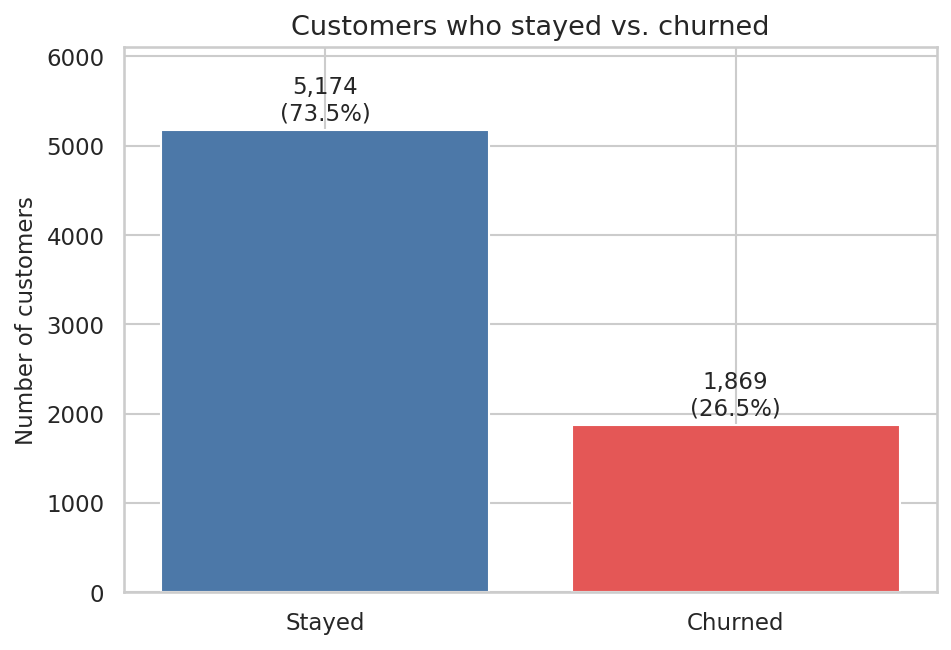

**Churners are newer customers who pay more per month.** Median tenure is 10 months for churners versus 38 for customers who stayed, and median monthly charges are $79.6 versus $64.4.

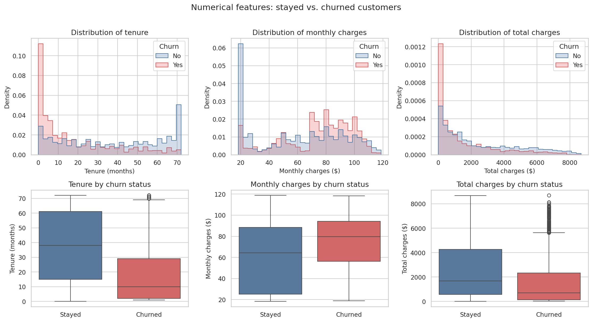

**Churn rate by customer characteristic and service.** Gender makes almost no difference, while internet service type, add-on services, senior citizen status, household ties (partner, dependents) and paperless billing show large gaps.

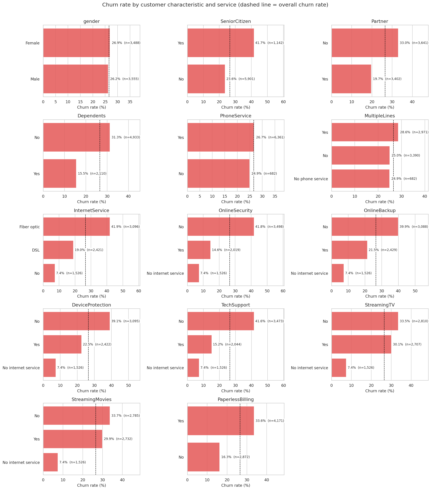

**Contract type, tenure, payment method and internet service are the strongest patterns.** Month-to-month customers churn at 42.7% versus 2.8% for two-year contracts, churn falls from 47.4% in the first year to 9.5% after four years, electronic-check payers churn at 45.3%, and fiber-optic customers at 41.9%.

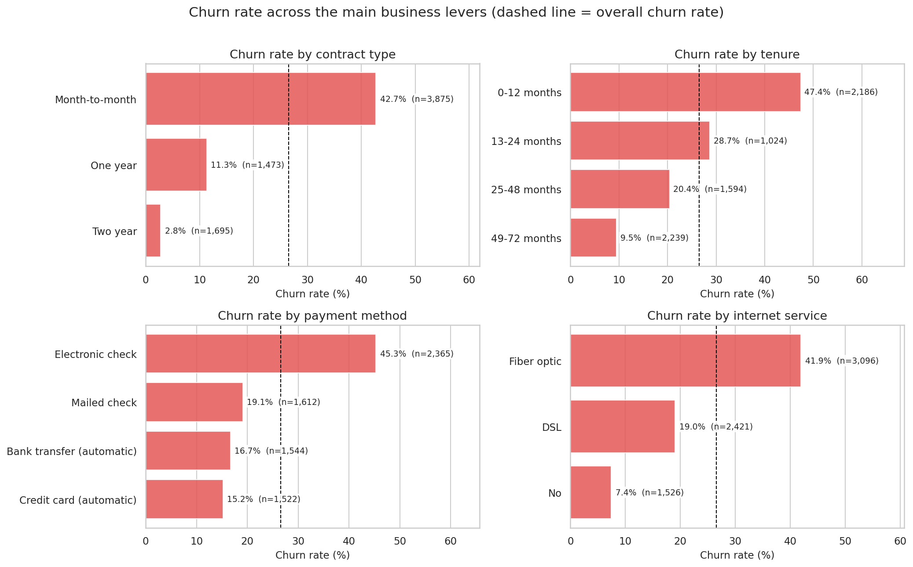

**Correlations.** Tenure has the strongest correlation with churn (-0.35). Total charges largely duplicates tenure and monthly charges (correlation with tenure 0.83), which matters when interpreting model coefficients.

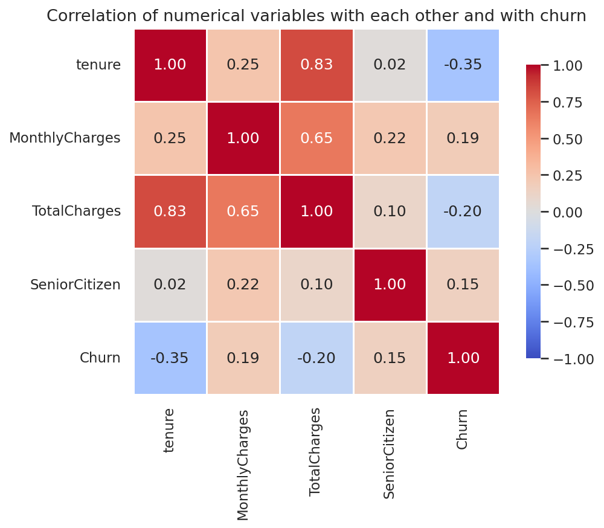

## Machine learning models and evaluation

Test-set results (1,409 customers, 374 of whom churned), at the default 0.5 threshold:

| Model | Accuracy | Precision | Recall | F1 | ROC-AUC |
|---|---|---|---|---|---|
| Baseline (always "stays") | 0.735 | 0.000 | 0.000 | 0.000 | 0.500 |
| **Logistic Regression** (selected) | 0.739 | 0.505 | 0.786 | 0.615 | 0.842 |
| Random Forest | 0.777 | 0.561 | 0.735 | 0.637 | 0.845 |

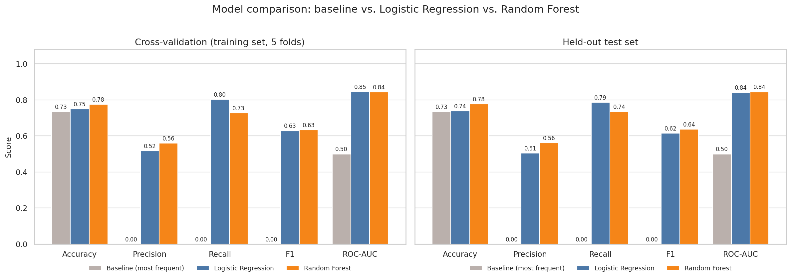

- **Both models clearly beat the baseline.** The baseline's 73.5% accuracy looks respectable but it identifies no churners at all.
- **The two models are very close on ranking ability** (ROC-AUC 0.842 vs 0.845; cross-validated 0.846 vs 0.844). The difference is the kind of mistake they make: Logistic Regression catches more churners (294 of 374, missing 80) but flags more loyal customers by mistake (288), while Random Forest catches 275 (missing 99) with 215 false alarms.
- **I selected Logistic Regression** using the cross-validation results (not the test set) because ranking ability is tied, it has higher recall (fewer missed churners), and its coefficients are easy to explain. This is a judgment call, and Random Forest would be a fair choice if false alarms were costly.

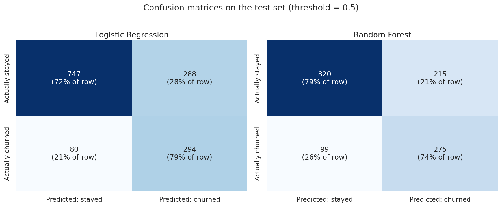

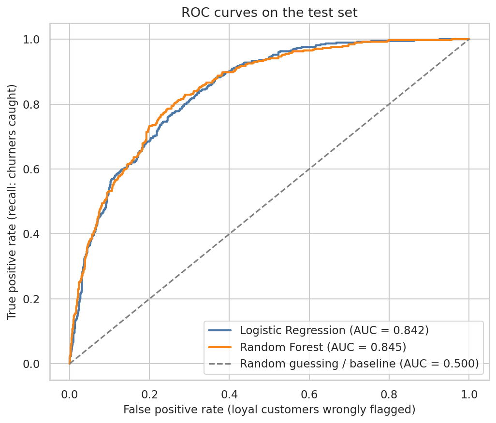

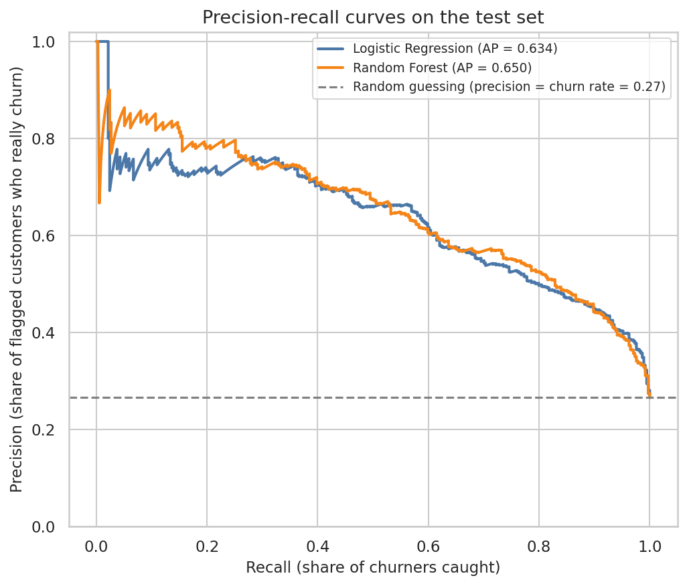

**Threshold.** The F1 curve is almost flat between thresholds of 0.45 and 0.65, and the cut-off chosen on training folds (0.60) did not beat the default on the test set (F1 0.610 vs 0.615), though it contacts fewer customers (precision 0.538, recall 0.703). The right threshold depends on the cost of a retention offer versus the value of a retained customer, which this dataset does not contain.

**Ranking for outreach.** Ranking test customers by predicted risk, the top 20% (282 customers) contains 186 churners, i.e. 49.7% of all churners, about 2.5 times better than picking customers at random.

## Key findings and business recommendations

**What drives the predictions.** Permutation importance shows the model relies mostly on tenure (by far the largest), internet service type and contract type, with monthly and total charges a distant fourth and fifth.

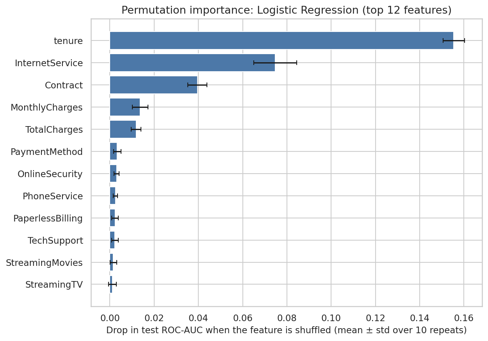

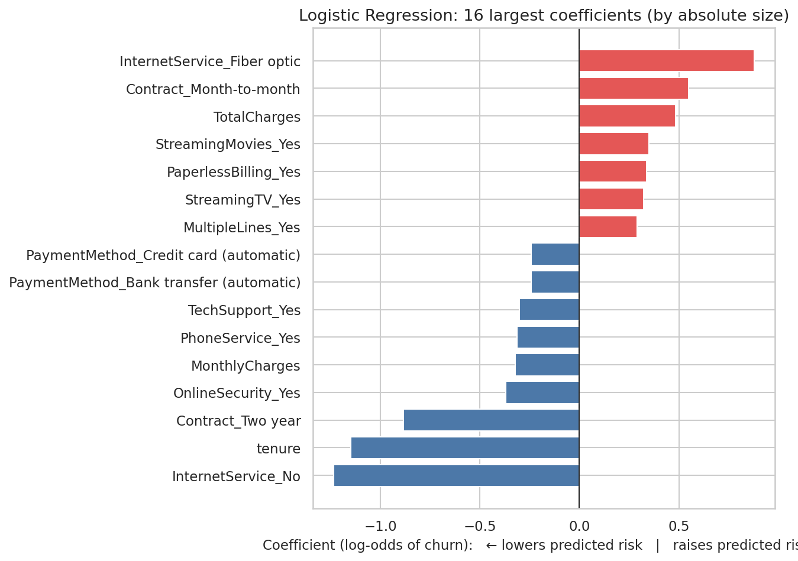

These are associations the model uses to predict churn, not proven causes. Overlapping features (monthly charges depend on services, total charges is roughly tenure times monthly charges) can produce coefficient signs that disagree with simple correlations, so I do not read individual coefficients as business insights.

| Finding in the data | Recommendation | Status |
|---|---|---|
| Month-to-month customers churn at 42.7% (vs 11.3% one-year, 2.8% two-year) and hold 88.6% of all churners | Focus retention on month-to-month customers, e.g. offers to move to longer contracts | Pattern observed; the effect of offers **needs testing** |
| Churn is 47.4% in the first 12 months; 55.5% of churners have tenure of 12 months or less | Add early-life contact in the first year | Pattern observed; **needs testing** |
| Fiber-optic customers churn at 41.9% vs 19.0% for DSL, and more within every contract type | Investigate the fiber customer experience (price, reliability, competition) | Data shows where, not why; **needs research** |
| Electronic-check payers churn at 45.3% vs 15-19% for other methods | Try encouraging automatic payment | May be a proxy for other traits; **needs testing** |
| Internet customers without tech support or online security churn at about 42% vs about 15% with them | Test trials of support or security services for at-risk customers | Association only; **needs testing** |
| Month-to-month + fiber + electronic check: 1,307 customers, 60.4% churn, 42.2% of all churners | Make this segment the first retention priority | Observed in the data |

To find out whether an offer actually works, the standard approach is an A/B test: randomly give the offer to some flagged customers and not others, then compare how many leave. The model tells us who is at risk, not whether an offer will change their decision. This project makes no claims about financial savings because the data has no cost or revenue information.

## How to install and run

```bash
# 1. Clone the repository and move into it
git clone <your-repository-url>
cd telecom-churn-prediction

# 2. (Recommended) create a virtual environment
python -m venv .venv
source .venv/bin/activate        # on Windows: .venv\Scripts\activate

# 3. Install dependencies
pip install -r requirements.txt

# 4. Open the notebook
jupyter lab notebooks/telecom_churn_analysis.ipynb
```

Then choose **Kernel > Restart Kernel and Run All Cells**. The notebook uses relative paths, so it works whether Jupyter is started from the project root or from `notebooks/`, and it regenerates every chart in `charts/`. Random seeds are fixed (`random_state=42`).

The results above were produced with Python 3.12, pandas 3.0, NumPy 2.4, scikit-learn 1.8, Matplotlib 3.10 and Seaborn 0.13. The minimum versions in `requirements.txt` are conservative estimates and have not been individually tested, so numbers could differ slightly on other versions.

## Limitations and future improvements

**Limitations**

- **Data:** one snapshot of 7,043 customers with unknown origin, so results may not transfer to another company or market.
- **Timing:** the data has no dates, so a time-based validation was not possible. For customers who left, `tenure` is how long they stayed before leaving, which means real-world performance on *future* churn could be lower than the test metrics suggest.
- **Missing information:** no satisfaction scores, complaints, network quality, usage, competitor offers or reasons for leaving.
- **Evaluation:** one train/test split with 374 test churners, no confidence intervals, so differences of about 0.02 between models should not be over-read. Models use untuned settings by design.
- **Interpretation:** importance scores and coefficients describe associations, not causes.
- **No real-world test:** nothing here shows that acting on the predictions reduces churn, and no deployment is claimed.

**Next steps**

1. Add uncertainty estimates (repeated cross-validation or bootstrapping the test set).
2. Try a gradient-boosting model with light tuning, using cross-validation only.
3. Replace the generic threshold with a cost-based one once offer costs and customer value are known, and check probability calibration.
4. Validate over time if dated data is available, and design the A/B test described above.
